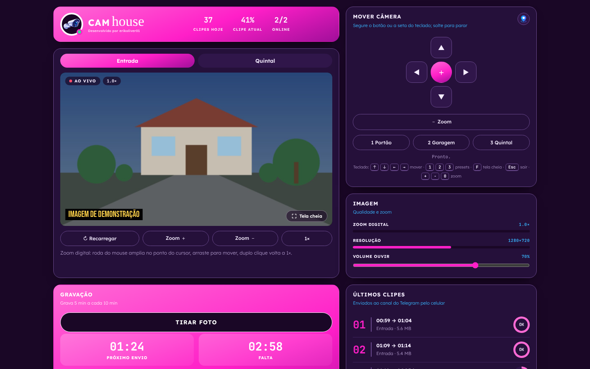
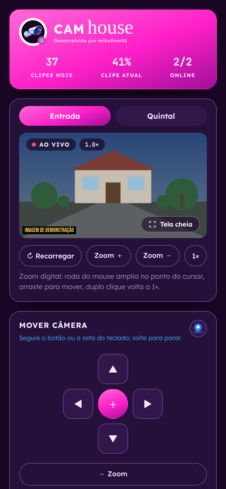
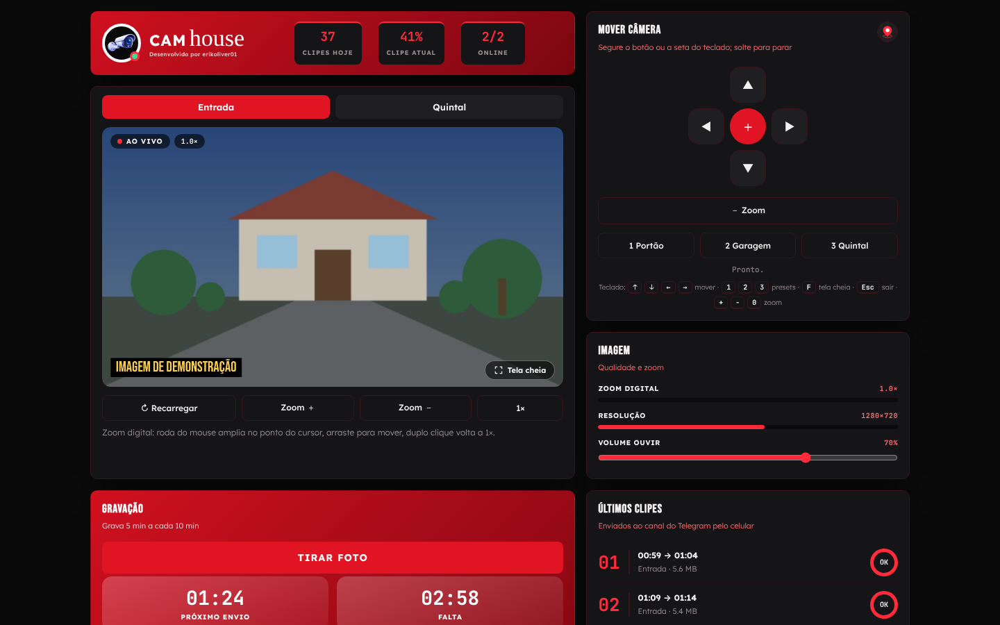

# CAM house

Programa caseiro para **ver, controlar e gravar câmeras Wi-Fi Xiongmai** (as que usam o app **iCSee** / XMEye) **sem depender da nuvem do fabricante**.

- Vídeo ao vivo no navegador (leve ou UHD), zoom digital e foto (snapshot)
- Mover a câmera (PTZ) segurando as setas e ir para posições salvas (presets)
- **Ouvir** o microfone da câmera, **falar** pelo alto-falante dela e tocar **sons**
- Painel de ajustes da câmera (luz, visão noturna, detecção etc.) e várias câmeras
- Gravação em clipes, com envio de cada clipe para um **canal do Telegram**
- Opcional: um **celular Android velho** grava e envia os clipes 24 h, sem o PC ligado
- Opcional: **app Android** que fala direto com as câmeras, e acesso de fora de casa pelo **Tailscale**

<p align="center">
  
  
</p>
<p align="center"></p>
<p align="center"><sub>Capturas com dados e imagem de demonstração.</sub></p>

Testado com câmeras **X3S-WQ-BL**. Outros modelos Xiongmai devem funcionar parecido, mas não foram testados.

> Projeto pessoal, sem relação com a Xiongmai, o iCSee, o Telegram ou o Tailscale. Use por sua conta e risco.

---

## Sumário
1. [Como as partes se encaixam](#1-como-as-partes-se-encaixam)
2. [Programas usados](#2-programas-usados)
3. [O que você vai preencher](#3-o-que-você-vai-preencher)
4. [Preparar as câmeras](#4-preparar-as-câmeras)
5. [Criar o bot e o canal do Telegram](#5-criar-o-bot-e-o-canal-do-telegram)
6. [Instalar no PC (Windows)](#6-instalar-no-pc-windows)
7. [Opcional: celular Android gravando 24 h](#7-opcional-celular-android-gravando-24-h)
8. [Opcional: acesso fora de casa com Tailscale](#8-opcional-acesso-fora-de-casa-com-tailscale)
9. [Opcional: app Android](#9-opcional-app-android)
10. [Sons e fontes](#10-sons-e-fontes)
11. [Segurança](#11-segurança)
12. [Problemas comuns](#12-problemas-comuns)
13. [Licença](#13-licença)

---

## 1. Como as partes se encaixam

```
pc/        servidor Node.js + página (public/index.html). Vídeo, PTZ, ajustes, falar, sons, gravação.
celular/   scripts para o Termux: um celular Android grava e manda os clipes ao Telegram.
android/   código do app "CAM house" (fala direto com as câmeras, sem o PC).
docs/      notas do protocolo da câmera (DVRIP, porta 34567).
```

A câmera conversa por dois caminhos: **DVRIP na porta 34567** (login, ajustes, PTZ, falar) e **RTSP na porta 554** (vídeo e áudio).
Você pode usar só o PC, só o celular gravando, só o app, ou tudo junto.

## 2. Programas usados

| Programa | Para quê | Onde | Versão que eu usei |
|---|---|---|---|
| [Node.js](https://nodejs.org) | roda o servidor (nenhum pacote npm) | PC | não anotada; use a LTS atual (20 ou mais nova) |
| [ffmpeg / ffprobe](https://www.gyan.dev/ffmpeg/builds/) | vídeo ao vivo, gravação, áudio, sons | PC (`pc/bin/`) e celular | celular: a do `pkg` do Termux |
| curl e ssh | envio ao Telegram; ler o status do celular | já vêm no Windows 10/11 | — |
| Microsoft Edge | janela do app no PC | PC | — |
| [Termux](https://f-droid.org/packages/com.termux/) + [Termux:Boot](https://f-droid.org/packages/com.termux.boot/) | rodar os scripts no celular | celular (opcional) | Termux 0.118.3, Termux:Boot 0.8.1 |
| [Magisk](https://github.com/topjohnwu/Magisk) | root (limite de carga, proteger a gravação) | celular (opcional) | 16.7 (Manager 5.8.3), num Android 9 antigo |
| [Tailscale](https://tailscale.com) | acesso de fora de casa | celular de casa + seu smartphone (opcional) | 1.104.4 |
| Android SDK (via [Android Studio](https://developer.android.com/studio)) | compilar o app | PC (opcional) | build-tools 36.0.0, platform android-35 |
| Java JDK | compilar o app | PC (opcional) | 21 |
| Telegram | guardar os clipes | qualquer | — |

"—" = não conferi a versão. As versões são as que eu tinha; outras devem funcionar, mas não testei.

## 3. O que você vai preencher

Nada de senha vem no repositório. Os arquivos `*.exemplo.*` são modelos: **copie, tire o `.exemplo` do nome e troque cada `PREENCHA_...`**.

| Campo | Onde | O que é |
|---|---|---|
| `PREENCHA_IP_DA_CAMERA_1`, `_2` | `pc/config.json`, `celular/config.sh`, ⚙ do app | IP da câmera na sua rede (ex.: `192.168.1.XX`) |
| `PREENCHA_USUARIO_DA_CAMERA_1`, `_2` | `pc/segredos.json`, `celular/segredos.sh`, ⚙ do app | usuário da câmera (geralmente `admin`) |
| `PREENCHA_SENHA_DA_CAMERA_1`, `_2` | `pc/segredos.json`, `celular/segredos.sh`, ⚙ do app | senha da câmera |
| `PREENCHA_TOKEN_DO_BOT` | `pc/segredos.json`, `celular/segredos.sh` | token do bot do Telegram ([passo 5](#5-criar-o-bot-e-o-canal-do-telegram)) |
| `PREENCHA_ID_DO_CANAL` | `pc/config.json`, `celular/config.sh` | ID do canal do Telegram (começa com `-100`) |
| `PREENCHA_SENHA_DO_APP` | `pc/segredos.json` | senha para abrir a página de outro aparelho (só com `"lan": true`) |
| `PREENCHA_IP_DO_CELULAR...` | `pc/config.json` | IP do celular que grava (ou apague o bloco `celular`) |
| `PREENCHA_USUARIO_STATUS` / `_SENHA_STATUS` | `celular/status/httpd.conf`, ⚙ do app | login do status do celular (opcional) |

Os arquivos preenchidos estão no `.gitignore` e **nunca** devem ir para o GitHub.

## 4. Preparar as câmeras

1. Instale cada câmera pelo app **iCSee** como o fabricante manda (ela precisa entrar no seu Wi-Fi).
2. No iCSee, troque a senha da câmera por uma **forte** (12 caracteres ou mais). Anote usuário e senha.
3. Descubra o **IP** da câmera: no roteador, na lista de aparelhos conectados (DHCP).
4. **Recomendado:** no roteador, reserve um IP fixo para cada câmera (procure "IP estático no DHCP" ou "reserva de DHCP", usando o MAC da câmera). Assim o IP não muda e você não precisa editar a configuração de novo.
5. **Recomendado:** se você não usa o iCSee fora de casa, desligue a nuvem da câmera. O CAM house não precisa dela.

## 5. Criar o bot e o canal do Telegram

### 5.1 Criar o bot
1. No Telegram, abra uma conversa com **@BotFather** (confira se é o oficial, com selo de verificado).
2. Mande `/newbot`.
3. Escolha um **nome** (ex.: `Minhas Câmeras`) e um **usuário** que termine em `bot` (ex.: `minhascameras_bot`).
4. O BotFather responde com o **token**, parecido com `123456789:AAH...`. Esse é o `PREENCHA_TOKEN_DO_BOT`.

> O token é uma senha: quem tiver ele controla o bot. Se vazar, mande `/revoke` ao @BotFather para gerar outro e atualize os arquivos.

### 5.2 Criar o canal
1. No Telegram: menu → **Novo canal** → dê um nome → escolha **Privado**.
2. Abra o canal → toque no nome → **Administradores** → **Adicionar administrador** → procure o usuário do seu bot → deixe ligada a permissão de **publicar mensagens** → salvar.

### 5.3 Descobrir o ID do canal
1. Poste qualquer mensagem no canal (ex.: "teste").
2. Jeito fácil, pelo PC (depois do [passo 6](#6-instalar-no-pc-windows), com o token já no `segredos.json`): na pasta `pc`, rode
   ```
   node find-channel.js
   ```
   Ele mostra o ID do canal, um número negativo que começa com `-100`. Esse é o `PREENCHA_ID_DO_CANAL`.
3. Jeito manual: abra no navegador `https://api.telegram.org/botSEU_TOKEN/getUpdates` e procure `"chat":{"id":-100...`. Não compartilhe esse link: ele contém o token.

> Até onde sei, bots só conseguem enviar arquivos de até ~50 MB (confira na [documentação da Bot API](https://core.telegram.org/bots/api#sending-files)). Clipes do substream ficam bem abaixo disso.

## 6. Instalar no PC (Windows)

1. Instale o **Node.js** (versão LTS) em https://nodejs.org. O lançador procura em `C:\Program Files\nodejs\node.exe` (o lugar padrão).
2. Baixe este repositório: botão verde **Code → Download ZIP**, e extraia.
3. Baixe o **ffmpeg** para Windows (ex.: "release essentials" em https://www.gyan.dev/ffmpeg/builds/) e copie `ffmpeg.exe` e `ffprobe.exe` para `pc\bin\`.
4. Na pasta `pc`:
   - copie `config.exemplo.json` → `config.json` e preencha os IPs, nomes das câmeras e o ID do canal;
   - copie `segredos.exemplo.json` → `segredos.json` e preencha usuários, senhas, token do bot e a senha do app.
   - Os `id` das câmeras (`porta`, `camera2`) precisam ser iguais nos dois arquivos. Para uma câmera só, apague o segundo bloco nos dois.
   - Se não for usar o celular gravando, apague o bloco `"celular"` do `config.json`.
5. Dê dois cliques em **`start.bat`**. Ele sobe o servidor escondido e abre o app numa janela do Edge. Fechar a janela encerra o servidor.
   Alternativa: num terminal dentro de `pc`, `node server.js` e abra http://127.0.0.1:8787.
6. Teste: vídeo ao vivo, foto, setas, "Ouvir" e "Falar". Os testes ficam em `node teste-sons.js` (sem câmera) e `node test-recorder.js` (usa a câmera).

Opções do `config.json`:
- `recording.enabled`: `true` grava no PC (pasta `pc\gravacoes\`) e manda ao Telegram. **Se o celular for gravar, deixe `false`** para não chegar clipe repetido.
- `recording.segmentSeconds`: duração do clipe (600 = 10 min). `keepLocalCopies: true` mantém cópia no PC depois do envio.
- `liveStream` / `recordStream`: `0` = imagem principal (pesada, UHD), `1` = substream (leve).
- `server.lan`: `true` deixa abrir a página de outro aparelho (`http://IP_DO_PC:8787`), **sempre pedindo a senha do app**. `false` = só no próprio PC.

## 7. Opcional: celular Android gravando 24 h

Um celular velho, sempre no carregador e no Wi-Fi, grava as câmeras e manda os clipes ao Telegram sem precisar do PC. Eu usei um Moto G de 2014 com Android 9.

1. No celular, instale o **F-Droid** (https://f-droid.org) e, por ele, **Termux** e **Termux:Boot**. Os dois precisam vir do mesmo lugar; não misture com a Play Store.
2. Abra o Termux e rode, uma linha por vez:
   ```
   pkg update -y && pkg upgrade -y
   pkg install -y ffmpeg curl
   termux-setup-storage
   ```
3. Copie a pasta `celular` deste repositório para o celular (cabo USB, pasta **Download**) e, no Termux:
   ```
   cp -r ~/storage/downloads/celular ~/cambox
   cd ~/cambox
   cp config.exemplo.sh config.sh
   cp segredos.exemplo.sh segredos.sh
   chmod 600 segredos.sh
   ```
4. Edite os dois arquivos (`nano config.sh` e `nano segredos.sh`) e troque os `PREENCHA_...`.
5. Teste: `bash ~/cambox/testar.sh`. Deve mostrar o vídeo de cada câmera e mandar uma mensagem ao canal.
6. Ligue: `bash ~/cambox/iniciar.sh`. Ver como está: `bash ~/cambox/status.sh`. Parar: `bash ~/cambox/parar.sh`.
   Por padrão grava 5 min a cada 10 min (`SEG` e `CICLO` no `config.sh`). Para gravar sem pausa, ponha `CICLO` igual a `SEG`.
7. Para ligar sozinho quando o celular reiniciar:
   ```
   mkdir -p ~/.termux/boot
   cp ~/cambox/boot-iniciar-cambox ~/.termux/boot/
   chmod +x ~/.termux/boot/boot-iniciar-cambox
   ```
   e abra o app **Termux:Boot** uma vez. Reinicie o celular para testar.
8. Nas configurações do Android, tire **Termux** e **Termux:Boot** da otimização de bateria.

**Status do celular no PC (opcional):** a página do PC mostra os últimos clipes lendo o celular por SSH.
No Termux: `pkg install -y openssh`, `passwd` (crie uma senha) e `sshd`. No PC, gere uma chave com
`ssh-keygen -t ed25519 -f pc\celular\ssh\id_ed25519` (crie as pastas antes), copie o conteúdo do `.pub` para `~/.ssh/authorized_keys` no Termux,
e preencha o bloco `celular` do `config.json` (o Termux usa a porta 8022).

**Root (opcional, avançado):** com root (Magisk), o `iniciar.sh` também liga o limite de carga (`limite-carga.sh`), a proteção contra o Android fechar a gravação (`protege.sh`) e o status para o app (`status-web.sh`; copie `status/httpd.exemplo.conf` para `status/httpd.conf` e preencha). Root tem riscos; só faça se souber o que está fazendo. Detalhes em [celular/LEIA-ME.md](celular/LEIA-ME.md).

## 8. Opcional: acesso fora de casa com Tailscale

O Tailscale cria uma rede privada entre os seus aparelhos. **Não abra portas no roteador** para as câmeras nem para o app.

1. Crie uma conta em https://tailscale.com e instale o app no aparelho que fica em casa (o celular que grava ou o PC) e no seu smartphone, com a mesma conta.
2. No aparelho de casa, ative **"anunciar rotas de sub-rede"** (subnet router) com a faixa da sua rede (ex.: `192.168.1.0/24`) e aprove a rota no painel de administração do Tailscale, na página desse aparelho.
3. **Recomendado:** em vez da rede inteira, anuncie só os IPs necessários (ex.: `192.168.1.XX/32` de cada câmera e do PC) ou limite com as ACLs do Tailscale.
4. No smartphone, ligue o uso de sub-redes ("Use Tailscale subnets"). Se o app tiver "split tunneling", **não** marque o app CAM house nem o navegador (marcado = fica fora do Tailscale).
5. Abra o app CAM house (ou `http://IP_DO_PC:8787` no navegador, com `"lan": true`) normalmente, como se estivesse em casa.

## 9. Opcional: app Android

O app fala direto com as câmeras (vídeo H.265, PTZ, ajustes, ouvir, falar, sons, mapa da casa) e mostra o status do celular que grava. Precisa de Android 8.0 ou mais novo.

Compilar (Windows, sem Gradle, só com o SDK):
1. Instale o **Android Studio** (ele baixa o SDK em `%LOCALAPPDATA%\Android\Sdk`). No SDK Manager, instale **Build-Tools 36.0.0** e **Android 15 (API 35)**, ou ajuste as versões no topo do `android\build.ps1`.
2. Tenha um **JDK** com `javac` e `jar` no PATH (eu usei o 21).
3. Abra o Android Studio uma vez para ele criar a chave de debug (`%USERPROFILE%\.android\debug.keystore`).
4. (Opcional) Coloque seus sons `.al` em `android\assets\sons\` ([passo 10](#10-sons-e-fontes)).
5. Rode:
   ```
   powershell -ExecutionPolicy Bypass -File android\build.ps1
   ```
   O APK sai em `android\build\CAMhouse.apk`. Instale no celular (permita "fontes desconhecidas" para o instalador que você usar).
6. No app, toque em ⚙ e preencha IP, usuário e senha de cada câmera. Tudo fica salvo só no celular.

> A chave de debug serve para uso próprio. Para distribuir o APK, gere uma chave de release sua e assine com ela.

## 10. Sons e fontes

**Sons:** nenhum som vem no repositório. Use só áudios que você tem direito de usar.
- PC: na pasta `pc`, `node converter-som.js "meu som.mp3"` cria `pc\sons\meu-som.al` (A-law 8 kHz, até 60 s). Cada `.al` da pasta vira um botão no menu **Sons**.
- App: copie os `.al` para `android\assets\sons\` antes de compilar, ou use **"Escolher do celular"** dentro do app.
- Também dá para tocar qualquer arquivo na hora pelo botão "Escolher arquivo" (até 10 MB, toca até 60 s).

**Fontes:** vêm só fontes livres (Lexend e Bebas Neue, SIL Open Font License, com a licença ao lado). Os temas e o nome do app usam a fonte do sistema no lugar das fontes de uso pessoal do visual original. Para usar outra fonte, coloque um `@font-face` com o nome `LemonCam`, `RasleyHouse` ou `QuantumFuturistic` no `pc\public\index.html` (ou o `.ttf` em `android\assets\fonts\`), desde que a licença dela permita.

## 11. Segurança

- **Nunca** publique `segredos.json`, `segredos.sh`, `config.json`, `config.sh`, `httpd.conf`, chaves SSH, logs, gravações nem backups.
- Use senha forte nas câmeras e no app; desligue a nuvem da câmera se não usar o iCSee fora de casa.
- Não abra portas no roteador; para acesso externo use Tailscale (de preferência limitado aos IPs necessários).
- Na rede de casa o tráfego **não é criptografado** (HTTP e RTSP, a senha da câmera vai no endereço RTSP): quem estiver no seu Wi-Fi pode capturar. Use uma senha de Wi-Fi forte e, se der, uma rede separada para visitas.
- O celular com root e Android antigo deve ser usado só para isso.

## 12. Problemas comuns

| Sintoma | O que conferir |
|---|---|
| "login/senha nao configurados" | `segredos.json`: os `id` batem com o `config.json`? Ainda tem `PREENCHA`? |
| Login falha (Ret=203) | senha errada. Depois de uma falha o PC espera 1 min antes de tentar de novo (senha errada repetida pode bloquear a câmera). |
| Sem vídeo | IP mudou? (reserve no roteador) · `ffmpeg.exe` está em `pc\bin\`? |
| Clipe não chega no Telegram | bot é administrador do canal? `chatId` começa com `-100`? Teste com `celular/testar.sh`. |
| Celular para de gravar | tire o Termux da otimização de bateria; confira `bash ~/cambox/status.sh` e os logs em `~/cambox/logs/`. |

## 13. Licença

Código sob a licença **MIT**: veja [LICENSE](LICENSE). As fontes Lexend e Bebas Neue seguem a SIL Open Font License (arquivos `OFL-*.txt`).
